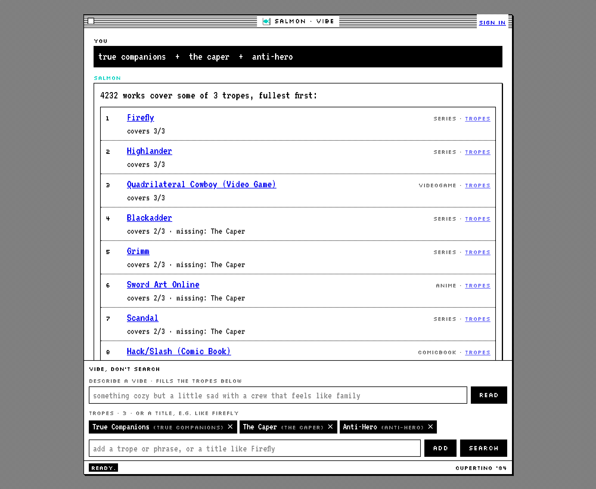

# salmon

Search movies, anime and TV shows by combining tropes, using TVTropes data.
You type a few tropes or a title, and salmon ranks works by how many of those tropes they have.



## Quick start

You need Python 3.12, Node 20.9 or newer, `make`, and about 9 GB of free disk.

```sh
git clone https://github.com/osama-alharbi9/salmon-search.git
cd salmon-search
make install   # Python venv, Node packages, backend/.env
make data      # downloads the dump (about 6 GB) and the e5 model, then builds everything
make run       # API on port 8000, web UI on port 3000
```

Open <http://localhost:3000/app>. The API takes about 30 seconds to load the data and model at startup.

`make data` took 5 minutes on an Apple Silicon Mac on a fast connection. For a quick look without the download, `make sample-data` builds a tiny invented dataset from the test fixtures.

If a port is taken, choose others. The API has to allow the new UI address:

```sh
SALMON_CORS_ORIGINS=http://localhost:3100 SALMON_FRONTEND_URL=http://localhost:3100 make run UI_PORT=3100
```

### Optional settings

Trope search needs no keys and no database server. These go in `backend/.env`:

| Setting | What it turns on |
|---|---|
| `ANTHROPIC_API_KEY` | The vibe field and `/api/ask`. Both use Claude Haiku. Change the models with `SALMON_VDS_MODEL` and `SALMON_MODEL`. |
| `DATABASE_URL` | Postgres for accounts and saved searches. When empty, they use a SQLite file at `backend/data/salmon.db`. |
| `SALMON_SESSION_SECRET` | A fixed key for login cookies. When empty, logins reset each time the server restarts. |
| `GOOGLE_CLIENT_ID`, `GOOGLE_CLIENT_SECRET` | Google sign-in. |

## Example queries

Type each part into the tropes field and press Add, or open a URL such as `/app?q=true companions + the caper + anti-hero`. Then press Search.

| Query | Result |
|---|---|
| `true companions`, `the caper`, `anti-hero` | Firefly, Highlander and Quadrilateral Cowboy cover all 3. 4,232 works cover at least 1. |
| `time travel`, `stable time loop`, `movies only` | Interstellar and Star Trek: First Contact lead, limited to film. |
| `the office` | A title of two or more words becomes that work's distinctive tropes, and The Office itself is left out of the results. |
| `like Cowboy Bebop`, `anime only` | `like` forces the title reading, which one-word titles need. Ghost in the Shell: Stand Alone Complex leads. |
| `unreliable narrator`, `no fanfic` | Words like `only`, `no`, `just` and `without` next to a medium set a filter. They never count as tropes. |

The chips show which real trope each phrase resolved to, so check them. Phrase resolution is loose: `found family` lands on `Found Family via Work`, while `true companions` is the page name with far more works behind it.

There are also two command line tools, run from `backend/` with the venv active:

```sh
python -m salmon.search "true companions + the caper + anti-hero"
python -m salmon.recommend cowboy bebop -n 10
```

## How the ranking works

1. **Resolve.** Each phrase is embedded with `multilingual-e5-small` and matched against embeddings of all 33,164 trope names and definitions. On a near tie it picks the trope more works use. A best match under 0.80 cosine is reported as unknown.
2. **Expand titles.** A title becomes up to 12 of its most distinctive tropes: the rarest ones that appear in at least 8 works. The source work is removed from the results.
3. **Score by coverage.** Every work is scored by how many of the wanted tropes it lists, using exact name matches. Partial matches stay in, below fuller ones. Ties go to the work with the longer trope list.

Embeddings only decide which tropes you meant. They do not rank works, because `e5-small` places trope phrases too close together to separate works by similarity.

The two command line tools score differently:

- `salmon.search` also gives half credit for a semantically close trope (cosine of 0.86 or more).
- `salmon.recommend` and `/api/ask` use cosine similarity between TF-IDF trope vectors, so rare shared tropes count most.

## Project structure

```
backend/
  salmon/            Search engine and data builders
    fetch.py           Download the raw dump
    parse.py           Dump to works.json and tropes.json
    profiles.py        TF-IDF work vectors
    enrich.py          Intro text and source URL per work
    embed.py           Trope embeddings
    engine.py          Coverage ranking, title lookup, recommendations
    search.py          Phrase resolution and the search CLI
    recommend.py       Recommendation CLI
  app/               FastAPI app
    main.py            Routes and startup
    vds.py             Medium filters, title detection, phrase resolution
    llm.py             Claude client and chat tool loop
    auth.py, db.py     Accounts and database models
    saved.py           Saved searches, saved works, history
  tests/             Offline tests on an invented fixture dataset
  data/              Dump, built artifacts, SQLite file (not committed)
frontend/            Next.js web UI
docs/DESIGN.md       The Cupertino '84 design system used by the UI
Makefile             install, data, run, test, lint
```

The engine loads the built files from `backend/data/artifacts` when the API starts. `SALMON_DATA_DIR` and `SALMON_ARTIFACT_DIR` move the dump and the artifacts.

## Development

```sh
make test   # backend tests, offline, a few seconds
make lint   # ruff and eslint
```

CI runs lint, tests and a frontend build on pushes and pull requests to `dev` and `production`. `requirements.txt` is the pinned lock generated from `requirements.in`.

## Data and licensing

**The code is MIT licensed.** See [LICENSE](LICENSE).

**The data is not in this repository.** `make fetch` downloads a pinned revision of [RyokoExtra/TvTroper-Cleaned](https://huggingface.co/datasets/RyokoExtra/TvTroper-Cleaned) from Hugging Face.

The content comes from [TVTropes](https://tvtropes.org) and its contributors, under a Creative Commons Attribution-NonCommercial-ShareAlike (CC BY-NC-SA) license. The site footer states the exact version. That has three consequences for anything you build with it:

- Credit TVTropes. The UI links each work back to its TVTropes page.
- Do not use the data commercially.
- Share anything you derive from the data, including the built artifacts, under the same license.

The dataset's Hugging Face card lists Apache 2.0. That label comes from whoever published the dump and does not change the license of the underlying TVTropes text, so treat the data as CC BY-NC-SA.

The embedding model, [intfloat/multilingual-e5-small](https://huggingface.co/intfloat/multilingual-e5-small), is MIT licensed and is downloaded on first use.

## Roadmap

- Better phrase resolution, so everyday wording reaches the main trope page
- Near matches in the web UI, as the search CLI already does
- A filter for parsing noise, such as episode names listed as tropes
- Database migrations with Alembic
- A smooth-type option for readers who find bitmap fonts hard to read
